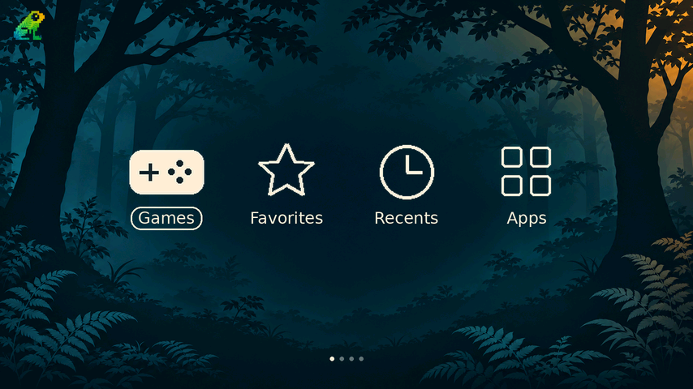

**TreeFrogUI-Horizontal** is the new default for fresh setups. It comes with a larger, easier-to-read launcher, the **Emerald** palette, and seven forest wallpapers at the native R36SX and SF3000 resolutions.

## Changes since v2.0.0_e

- **Make it yours.** Open **Settings → Appearance → Wallpaper** to choose Midnight Cyan, Indigo Dusk, Sunset Canopy, Aurora Bloom, Golden Grove, the original Plum, Teal & Olive, or Cyan, Green & Gold. Custom wallpapers also work. **Theme colours** remembers the Horizontal palette independently of the original TreeFrogUI and ProMinimal palettes. The offline updater backs up your previous settings.
- **Change the game browser on the fly.** Press **Y** or **L2** at the Explore Content system list to cycle through the vertical list, horizontal carousel, and system grid. The footer shows the shortcut and a toast names the new layout. **Select** still opens the core picker.
- **Sharper wide-screen theme art.** The installer retains optional 854 × 480 artwork for the SF3000 and falls back to the 640 × 480 assets when a theme only supplies those. TreeFrogUI-Horizontal is preinstalled and also available as a `.muxthm` in `ARCHIVE/`.
- **Clearer menus.** Improved focus indicators and selected-row contrast in imported themes, including disabled settings, and adjusted spacing for themed list rows. The legacy battery overlay is cleared across a wider area when the TreeFrogUI battery indicator is selected.
- **Settings defaults.** ProMinimal defaults to AliumBoy colours. File caching is off by default for fresh settings.
- The [theming guide](https://tzubertowski.github.io/TreeFrogUI/guides/theming/) now explains where to put `.muxthm` files, how to install them, and which theme features TreeFrogUI supports.

Horizontal’s archive layout took cues from **Analogue**, ported to MuOS by **Cheema OTB** from the original by **Aemiii91**. The forest artwork and launcher icons were made for TreeFrogUI-Horizontal. [MustardOS theme library](https://theme.muos.dev/)

The launcher artwork and all seven wallpapers were checked in QEMU at 640 × 480 and 854 × 480. Imported themes can render differently depending on the MuOS features they use.
